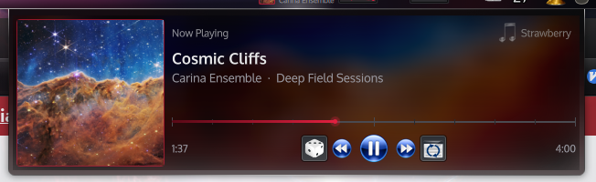

# Now Playing

A KDE Plasma 6 media widget. It shows album art over a blurred copy of the cover, the title, artist and album, a seek line with grid ticks and a glowing head, and media controls drawn from your icon theme. It works with any MPRIS player: Strawberry, Spotify, Firefox, VLC, mpv and others.

- Click the seek line to jump. Scroll anywhere on the card to change volume.
- The controls are shuffle, previous, play/pause, next and repeat. Repeat cycles off → playlist → track; a small "1" badge marks repeat-one.
- When several players are running, click the player chip in the top right to switch between them.
- In a panel the widget shows a small album-art thumbnail (crimson border while playing, dimmed with a pause icon while paused) next to the track title and artist. Click it to open the card; middle-click to play or pause; scroll to change volume.

  

Install with `kpackagetool6 -t Plasma/Applet -i package`. Upgrade with `kpackagetool6 -t Plasma/Applet -u package`.

**Note:** the widget uses Plasma's *private* MPRIS QML module (`org.kde.plasma.private.mpris`), the same one the stock Media Player widget uses. A major Plasma release could change that API.

Screenshot album art: *Cosmic Cliffs* in the Carina Nebula, NASA, ESA, CSA, STScI. The track metadata in the screenshots is made up.
