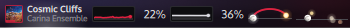

# Now Playing

A KDE Plasma 6 media widget and music scrobbler. It shows album art over a blurred copy of the cover, the title, artist and album, a seek line with grid ticks and a glowing head, and media controls drawn from your icon theme. It works with any MPRIS player: Strawberry, Spotify, Firefox, VLC, mpv and others.

- Click the seek line to jump. Scroll anywhere on the card to change volume.
- The controls are shuffle, previous, play/pause, next and repeat. Repeat cycles off → playlist → track; a small "1" badge marks repeat-one.
- When several players are running, click the player chip in the top right to switch between them.
- In a panel the widget shows a small album-art thumbnail (crimson border while playing, dimmed with a pause icon while paused) next to the track title and artist. Click it to open the card; middle-click to play or pause; scroll to change volume.

  

## Scrobbling

Since 2.0 the widget also keeps track of what you listen to. A track counts as a listen once you've played half of it or four minutes, whichever comes first; tracks shorter than 30 seconds never count. Only real playback time counts, so pausing and seeking don't cheat the rule, and playing a song again on repeat counts as a new listen.

- **Local history.** Every listen is saved in a SQLite database on your computer: `~/.local/share/plasmashell/QML/OfflineStorage/Databases/1c28efa149ed56f0d3b592a8f7f6730e.sqlite` (table `listens`). This works without an account.
- **ListenBrainz.** Paste your user token (from [listenbrainz.org/settings](https://listenbrainz.org/settings/)) under *Configure → Scrobbling* and press *Check*. The widget sends "playing now" updates and uploads each listen. Listens made while offline wait in a queue and are uploaded when the connection returns.
- **Players.** *Don't upload from* is for players that already scrobble by themselves. It defaults to `strawberry`, so Strawberry listens are not sent twice, but they still appear in your local history. *Never record* skips a player completely, for example a browser.
- **In the panel** a thin crimson line along the bottom of the album thumbnail fills up as the track gets closer to counting, and stays solid once it has. The tooltip says how long is left.
- **The card** has three tabs: *Now Playing*, *History* (recent listens, with a dot showing whether each one is on ListenBrainz, queued, or kept locally) and *Stats* (today, the last 7 days, your streak, a 14-day chart and the week's top artists).

The widget follows the player shown on the card, which is the one that's playing unless you picked another with the player chip.

## Tests

`node tests/run.mjs` runs the unit tests for the scrobbling rules. `tests/harness.qml` runs the scrobbler headless against a fake MPRIS player and a fake ListenBrainz server (`tests/mock_player.py`, `tests/mock_listenbrainz.py`); see the comments in each file.

Install with `kpackagetool6 -t Plasma/Applet -i package`. Upgrade with `kpackagetool6 -t Plasma/Applet -u package`.

**Note:** the widget uses Plasma's *private* MPRIS QML module (`org.kde.plasma.private.mpris`), the same one the stock Media Player widget uses. A major Plasma release could change that API.

Screenshot album art: *Cosmic Cliffs* in the Carina Nebula, NASA, ESA, CSA, STScI. The track metadata in the screenshots is made up.
